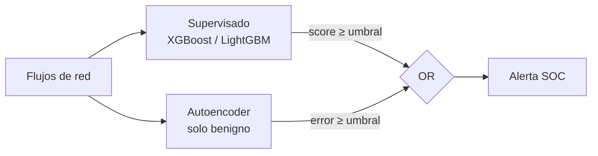

# Hybrid NIDS ML

Sistema **híbrido** de detección de intrusiones en red sobre flujos NetFlow. Combina un clasificador supervisado para ataques conocidos con un Autoencoder entrenado solo con tráfico benigno para ataques desconocidos, y se evalúa con las restricciones de un SOC real: **FPR < 0.1 %**.

> **Estado:** en desarrollo. Están listos la documentación, la configuración, las métricas, el ETL de CIC-IDS2017 y la capa supervisada. El Autoencoder y la fusión son stubs.

## Arquitectura



| Capa | Detecta | Entrena con |
|---|---|---|
| Supervisada | Familias conocidas: PortScan, Brute-Force, DoS/DDoS, Web Attacks, Botnet | Benigno + ataques etiquetados |
| No supervisada | Desvíos de lo normal, incluidos *zero-day* | Exclusivamente benigno |

## Datasets

| `--dataset` | Flujos | Benigno | Orden |
|---|---:|---:|---|
| `cicids2017` | 2 830 743 | 80.3 % | Primero |
| `unsw_nb15` | 2 540 044 | 87.4 % | Segundo |

Cada dataset tiene un adaptador en el ETL que emite un esquema común; el modelado no conoce el origen.

## Reglas anti-leakage

1. IPs, `Flow ID`, puerto de origen, timestamps e índices **nunca** son features.
2. El puerto destino y los TTL de UNSW-NB15 exigen ablación (*shortcut learning*).
3. Split cronológico por campaña, sin partir sesiones en la frontera. Sin splits aleatorios.
4. Escalado y selección de features ajustados solo con Train.
5. Umbrales calibrados **solo en Validación**. Test se evalúa una vez.
6. En LOAO, la familia excluida sale de Train y de Val.

## Evaluación

- **Recall @ FPR** de 0.1 %, 0.5 % y 1 %, y falsas alertas por 100k flujos benignos.
- **PR-AUC** en lugar de accuracy.
- **Recall por familia** y macro, para que los ataques masivos no oculten puntos ciegos.
- **Leave-One-Attack-Out** para medir detección *zero-day*.

## Documentación

| Documento | Contenido |
|---|---|
| [01 · Teoría de dominio](docs/01_domain_theory.md) | NIDS/HIDS, flujos, firmas de ataque, datasets y el problema del SOC |
| [02 · Arquitectura de procesos](docs/02_process_architecture.md) | Flujo de punta a punta, splits, calibración y LOAO |
| [03 · Arquitectura lógica](docs/03_logical_architecture.md) | Módulos, contratos, rutas y estado |
| [ETL y anti-leakage](docs/theory/01_etl_and_anti_leakage.md) | Limpieza, split por campaña, purga de sesiones y cifras medidas |
| [Capa supervisada](docs/theory/02_supervised_soc_baseline.md) | Calibración por FPR, gemelos, ablación y puntos ciegos |

## Estado del proyecto

| Componente | Estado |
|---|---|
| Documentación | ✅ Completa |
| `src/config.py`, `src/metrics.py` | ✅ Implementados y probados |
| `src/etl.py` | ✅ `cicids2017` · 🚧 `unsw_nb15` |
| `src/baseline_xgb.py` | ✅ Binario (XGBoost, LightGBM) |
| `src/autoencoder.py` | 🚧 Stub |
| `src/hybrid_eval.py` | 🚧 Stub |
| `src/visualize.py` | 🚧 Stub |

## Uso

```bash
git clone https://github.com/facupeletay/hybrid-nids-ml.git
cd hybrid-nids-ml
python -m venv .venv
source .venv/bin/activate        # Windows: .venv\Scripts\activate
pip install -r requirements.txt

python -m src.config             # muestra la configuración activa
python -m unittest -v            # pruebas

# ETL: carpeta con los CSV de GeneratedLabelledFlows, o un mirror de Kaggle
python -m src.etl --dataset cicids2017 --raw-dir RUTA
python -m src.etl --dataset cicids2017 --kaggle-dataset hgiabo2k5/generatedlabelledflows

# Capa supervisada, con ablación del puerto destino
python -m src.baseline_xgb --dataset cicids2017 --run-ablation
```

En Google Colab, montar Drive antes de importar `src.config`. Datos, modelos y métricas persisten en `/content/drive/MyDrive/hybrid_nids/`.

## Estructura

```
docs/             Documentación técnica
src/              Código del pipeline
tests/            Pruebas unitarias
notebooks/        Notebooks de Colab
data/             Crudos y procesados (ignorado por Git)
models/           Modelos entrenados (ignorados)
metrics/          Métricas en JSON (ignoradas)
reports/figures/  Figuras (ignoradas)
```
