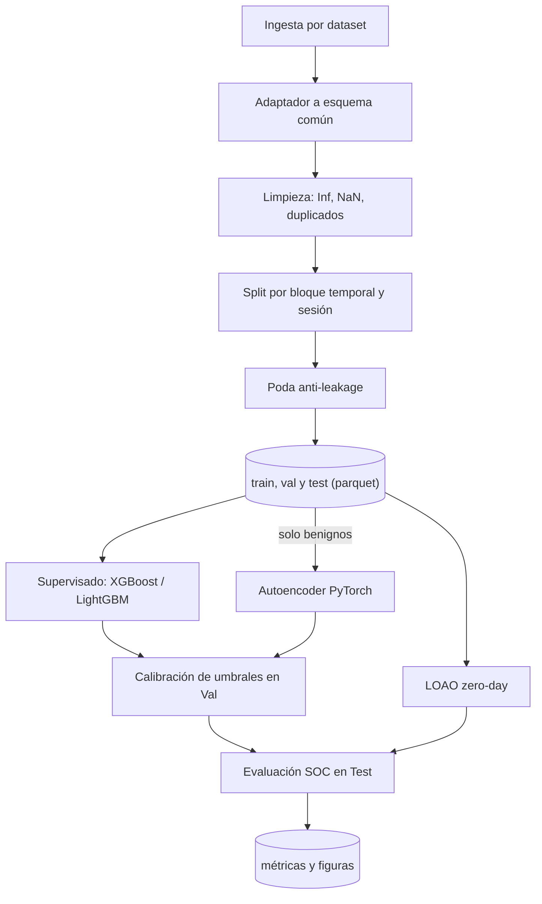

# 02 · Arquitectura de procesos

Flujo de punta a punta. Describe el diseño objetivo; el estado de implementación está en [03](03_logical_architecture.md#5-estado-de-los-módulos).

## 1. Vista general

**Orden de poda y split.** Conceptualmente la poda precede al modelado, pero el split *necesita* IPs y timestamps para no partir sesiones. Por eso esas columnas se tratan como metadata durante el split y se eliminan antes de escribir los parquets: ningún módulo de modelado llega a verlas.

## 2. Ingesta

- `--dataset {cicids2017,unsw_nb15}` selecciona el adaptador.
- Los crudos se guardan en `data/raw/<dataset>/` y no se modifican.
- La lectura es por archivo y con tipos reducidos (`float32`) para no agotar la RAM de Colab.
- El adaptador traduce etiquetas y emite el [esquema común](03_logical_architecture.md#2-contratos-de-datos).

## 3. Limpieza

1. Normalizar encabezados y etiquetas; eliminar filas vacías.
2. `Inf` → `NaN`. Eliminar las filas afectadas si son una fracción marginal; registrar cuántas y de qué clase.
3. Eliminar columnas duplicadas y constantes (la constancia se decide **mirando solo Train**).
4. Eliminar duplicados **exactos, metadata incluida** (el mismo flujo exportado dos veces).

Los flujos con features idénticas pero metadata distinta *no* se deduplican globalmente: PortScan y Patator producen miles por naturaleza, y colapsarlos altera el desbalance. Sí se mide cuántos de Val/Test tienen un gemelo en Train, y se reporta el recall con y sin ellos.

Cada paso registra filas de entrada y salida por clase.

## 4. Poda anti-leakage

| Columna | Por qué filtra | Tratamiento |
|---|---|---|
| `Flow ID` | Contiene la 5-tupla | Prohibida |
| IP origen / destino | En el laboratorio el atacante tiene IPs fijas | Prohibida |
| Puerto origen | Efímero: aprende sesiones o herramientas | Prohibida |
| Timestamp, `Stime`, `Ltime` | Cada ataque ocupa una ventana fija | Prohibida |
| `id` (UNSW-NB15) | El orden de fila correlaciona con la clase | Prohibida |
| Puerto destino | Informativo, pero *shortcut* (22 ⇒ SSH-Patator) | Ablación obligatoria |
| `sttl`, `dttl`, `ct_state_ttl` | Artefacto del generador de tráfico | Ablación obligatoria |

Las listas viven en `config.LEAKAGE_COLUMNS` y `config.SHORTCUT_PRONE_COLUMNS`. Los resultados se informan con y sin las segundas; si un modelo colapsa al quitarlas, había aprendido el laboratorio.

## 5. Split sin fuga de sesiones

Un split aleatorio pone flujos vecinos de la misma campaña en Train y Test e infla todas las métricas. Un corte temporal global tampoco sirve: cada familia ocurre en un solo día, y quedaría fuera de Train.

Estrategia: **bloques temporales contiguos dentro de cada campaña**.

1. Por cada día y etiqueta, ordenar por timestamp.
2. Dividir en bloques contiguos: 60 % Train, 20 % Val, 20 % Test.
3. Asignar cada sesión (5-tupla bidireccional cercana en el tiempo) a un único split.
4. Dejar un *embargo* entre bloques y descartar los flujos que caen en él.

El embargo debe ser mayor que la resolución del timestamp, que en CIC-IDS2017 puede ser de un minuto. Las familias ínfimas (Heartbleed, SQL Injection, Infiltration) se reportan, pero no sostienen conclusiones.

**Tamaño de Val.** Estimar un FPR de 0.1 % exige muchos benignos: con 100 000, el error estándar es ~0.01 puntos porcentuales; con 1 000, el umbral depende de un único flujo.

## 6. Modelado

### 6.1 Supervisado

- Binario y multiclase sobre familias canónicas, con pesos por clase.
- *Early stopping* por PR-AUC en Val.
- Score: `P(ataque)`, o `1 − P(BENIGN)` en multiclase.

### 6.2 Autoencoder

- Entrena **solo con `BENIGN` de Train**; el escalado se ajusta sobre ese mismo subconjunto.
- *Early stopping* con la pérdida sobre Val **benigno**.
- Score: error de reconstrucción por flujo.

### 6.3 Fusión

Alerta si **cualquiera** de las dos capas alerta. Los FPR se acumulan (cota de la unión):

$$
\text{FPR}_{\text{híbrido}} \le \text{FPR}_{\text{sup}} + \text{FPR}_{\text{AE}}
$$

Calibrar cada capa a 0.1 % por separado puede dar hasta 0.2 % en conjunto. El presupuesto se **reparte** entre ambas y se verifica el FPR conjunto en Val.

## 7. Calibración de umbrales

1. `find_threshold_for_fpr` sobre **Val**, por cada presupuesto (0.1 %, 0.5 %, 1 %).
2. El umbral se congela y se guarda junto al modelo.
3. Test se evalúa **una vez**, con `compute_binary_soc_metrics`.

El umbral garantiza el presupuesto en Val; el FPR de Test se **reporta** y puede excederlo. Si lo hace de forma sistemática hay drift, y la respuesta es documentarlo, no recalibrar con Test.

## 8. Leave-One-Attack-Out

Por cada familia $a$:

1. Quitar $a$ de Train **y de Val**: si queda en Val, contamina el early stopping.
2. Reentrenar el supervisado sin $a$.
3. Calibrar umbrales en Val, sin $a$.
4. Evaluar en Test: recall sobre $a$ de cada capa y del híbrido, y FPR sobre `BENIGN`.

El Autoencoder no ve ataques, así que se entrena una sola vez. Aun así, sus hiperparámetros no pueden elegirse mirando el recall de ataques.

La unidad es la **familia**, no la etiqueta: dejar fuera GoldenEye mientras Hulk sigue en Train no simula un zero-day.

## 9. Evaluación SOC

| Métrica | Pregunta que responde |
|---|---|
| Recall @ FPR 0.1 % | ¿Cuánto detecto sin inundar al analista? |
| Falsas alertas por 100k benignos | ¿Qué carga de trabajo genera? |
| PR-AUC | ¿Qué tan bien ordena, bajo desbalance? |
| Recall por familia y macro | ¿Qué ataques no veo? |
| Recall LOAO | ¿Qué pasa con lo desconocido? |

## 10. Ejecución

| | Local (CPU) | Google Colab |
|---|---|---|
| Uso | Desarrollo, tests, muestras | ETL masivo, entrenamiento (GPU) |
| Raíz | Raíz del repo | `/content/drive/MyDrive/hybrid_nids/` |
| Persistencia | Ignorada por Git | Google Drive |

En Colab, montar Drive **antes** de importar `src.config`: la raíz se resuelve al importar.
