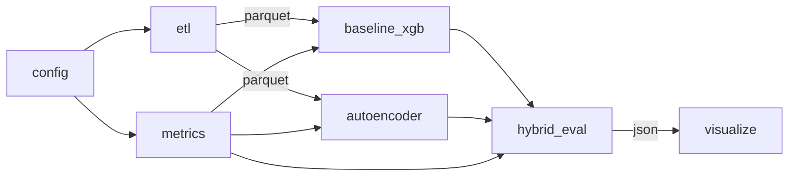

# 03 · Arquitectura lógica

Módulos, contratos y rutas.

## 1. Mapa de módulos

| Módulo | Responsabilidad | No hace |
|---|---|---|
| `config.py` | Rutas, constantes, listas anti-leakage | Tocar el disco al importarse |
| `etl.py` | Todo lo específico de cada dataset | Modelar |
| `baseline_xgb.py` | Capa supervisada | Conocer el dataset de origen |
| `autoencoder.py` | Capa no supervisada | Ver ataques al entrenar |
| `hybrid_eval.py` | Fusión y LOAO | Calibrar con Test |
| `metrics.py` | Métricas SOC puras | Leer o escribir archivos |
| `visualize.py` | Figuras desde métricas guardadas | Recalcular modelos |

**Desacople del dataset:** solo `etl.py` conoce nombres de columnas originales. Los demás reciben el esquema común, y tratan como feature toda columna que no sea de etiqueta.

## 2. Contratos de datos

### 2.1 Parquets procesados

`data/processed/<dataset>/{train,val,test}.parquet`

| Columna | Tipo | Contenido |
|---|---|---|
| features numéricas | `float32` | Finitas, sin columnas de `LEAKAGE_COLUMNS` |
| `is_attack` | `int8` | 0 benigno, 1 ataque |
| `attack_label` | `string` | Etiqueta original normalizada |
| `attack_family` | `string` | Familia canónica; `BENIGN` si es benigno |

Invariantes: `is_attack == 0` ⇔ `attack_family == "BENIGN"`; mismas columnas y orden en los tres splits; `find_leakage_columns(df.columns) == []`.

### 2.2 Scores

Vector 1-D de punto flotante, finito, mayor = más sospechoso, alineado por fila con el split. La alerta es `score >= threshold`. Val y Test deben usar el **mismo dtype**: el umbral se calcula en el de Val.

### 2.3 Artefactos

| Artefacto | Ruta |
|---|---|
| Modelo supervisado | `models/<dataset>_<backend>_<task>.json` / `.joblib` |
| Autoencoder | `models/<dataset>_autoencoder.pt` |
| Preprocesador | `models/<dataset>_preprocessor.joblib` |
| Métricas | `metrics/<dataset>_<experimento>.json` |
| Figuras | `reports/figures/<dataset>_<figura>.png` |

Las métricas indefinidas valen `nan`. `json.dumps` las escribe como `NaN`, que Python relee pero no es JSON estricto: quien las consuma desde otra herramienta debe convertirlas a `null`.

## 3. API implementada

### `config.py`

| Símbolo | Contrato |
|---|---|
| `resolve_storage_root(drive_root)` | Drive si está montado; si no, raíz del repo |
| `get_raw_dir(dataset)`, `get_processed_dir(dataset)` | Ruta; `ValueError` si el dataset no está soportado |
| `get_split_path(dataset, split)` | Ruta del parquet del split |
| `find_leakage_columns(columns)` | Columnas prohibidas presentes, tolerante a formato |
| `ensure_directories()` | Crea carpetas; advierte si es Colab sin Drive |

### `metrics.py`

| Función | Entrada | Salida |
|---|---|---|
| `compute_binary_soc_metrics` | `y_true`, `y_score`, `threshold` | `precision`, `recall`, `fpr`, `f1`, `roc_auc`, `pr_auc`, `confusion_matrix`, `alerts_per_100k_benign`, `n_benign`, `n_attack` |
| `find_threshold_for_fpr` | `y_true_val`, `y_score_val`, `max_fpr` | Umbral mínimo con `FPR <= max_fpr` en Val |
| `compute_per_attack_recall` | `attack_labels`, `y_pred_binary` | `per_attack`, `macro_recall`, `benign` |

## 4. Rutas dinámicas

| Constante | Local | Colab con Drive |
|---|---|---|
| `STORAGE_ROOT` | raíz del repo | `/content/drive/MyDrive/hybrid_nids` |
| `RAW_DIR` | `data/raw` | `…/data/raw` |
| `PROCESSED_DIR` | `data/processed` | `…/data/processed` |
| `MODELS_DIR` | `models` | `…/models` |
| `METRICS_DIR` | `metrics` | `…/metrics` |
| `FIGURES_DIR` | `reports/figures` | `…/reports/figures` |

## 5. Estado de los módulos

| Módulo | Estado | Pruebas |
|---|---|---|
| `src/config.py` | ✅ Implementado | `tests/test_config.py` |
| `src/metrics.py` | ✅ Implementado | `tests/test_metrics.py` |
| `src/etl.py` | 🚧 Stub | — |
| `src/baseline_xgb.py` | 🚧 Stub | — |
| `src/autoencoder.py` | 🚧 Stub | — |
| `src/hybrid_eval.py` | 🚧 Stub | — |
| `src/visualize.py` | 🚧 Stub | — |
| `notebooks/` | 🚧 Vacío | — |

Los stubs exponen firmas y CLI, y lanzan `NotImplementedError`.
