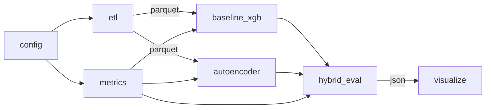

# 03 · Arquitectura lógica

Módulos, contratos y rutas.

## 1. Mapa de módulos

| Módulo | Responsabilidad | No hace |
|---|---|---|
| `config.py` | Rutas, constantes, listas anti-leakage | Tocar el disco al importarse |
| `etl.py` | Todo lo específico de cada dataset | Modelar |
| `baseline_xgb.py` | Capa supervisada | Conocer el dataset de origen |
| `autoencoder.py` | Capa no supervisada | Ver ataques al entrenar |
| `hybrid_eval.py` | Fusión y LOAO | Calibrar con Test |
| `metrics.py` | Métricas SOC puras | Leer o escribir archivos |
| `visualize.py` | Figuras desde métricas guardadas | Recalcular modelos |

**Desacople del dataset:** solo `etl.py` conoce nombres de columnas originales. Los demás reciben el esquema común, y obtienen las features con `config.get_feature_columns`, que excluye `METADATA_COLUMNS`.

## 2. Contratos de datos

### 2.1 Parquets procesados

`data/processed/<dataset>/{train,val,test}_<dataset>.parquet`

| Columna | Tipo | Contenido |
|---|---|---|
| features numéricas | `float32` | Finitas, sin columnas de `LEAKAGE_COLUMNS` |
| `is_attack` | `int8` | 0 benigno, 1 ataque |
| `attack_family` | `string` | Familia canónica; `BENIGN` si es benigno |
| `label_raw` | `string` | Etiqueta original normalizada |
| `campaign_day` | `string` | Captura de origen. Identifica el ataque: **nunca es feature** |

Invariantes: `is_attack == 0` ⇔ `attack_family == "BENIGN"`; mismas columnas y orden en los tres splits; `find_leakage_columns(df.columns) == []`.

### 2.2 Scores

Vector 1-D de punto flotante, finito, mayor = más sospechoso, alineado por fila con el split. La alerta es `score >= threshold`. Val y Test deben usar el **mismo dtype**: el umbral se calcula en el de Val. La capa supervisada usa siempre `float64`.

### 2.3 Artefactos

| Artefacto | Ruta |
|---|---|
| Modelo supervisado | `models/xgb_baseline_<dataset><sufijo>.json` (XGBoost) / `.txt` (LightGBM) |
| Reporte supervisado | `metrics/xgb_baseline_<dataset><sufijo>.json` |
| Autoencoder | `models/<dataset>_autoencoder.pt` |
| Scaler (benigno de Train) | `data/processed/<dataset>/scaler_<dataset>.joblib` |
| Metadata del ETL | `data/processed/<dataset>/etl_metadata_<dataset>.json` |
| Otras métricas | `metrics/<dataset>_<experimento>.json` |
| Figuras | `reports/figures/<dataset>_<figura>.png` |

El `<sufijo>` combina `--tag`, `_lgbm` y `_no_dst_port`, para que ninguna variante pise a otra.

Las métricas indefinidas valen `nan` en memoria y `null` en los reportes, que son JSON estricto (`baseline_xgb.to_strict_json`).

## 3. API implementada

### `config.py`

| Símbolo | Contrato |
|---|---|
| `resolve_storage_root(drive_root)` | Drive si está montado; si no, raíz del repo |
| `get_raw_dir(dataset)`, `get_processed_dir(dataset)` | Ruta; `ValueError` si el dataset no está soportado |
| `get_split_path(dataset, split)` | Ruta del parquet del split |
| `get_scaler_path(dataset)`, `get_etl_metadata_path(dataset)` | Rutas de los demás artefactos del ETL |
| `get_baseline_model_path(dataset, tag, extension)`, `get_baseline_report_path(dataset, tag)` | Rutas de la capa supervisada |
| `find_leakage_columns(columns)` | Columnas prohibidas presentes, tolerante a formato |
| `get_feature_columns(columns)` | Columnas que no son metadata |
| `ensure_directories()` | Crea carpetas; advierte si es Colab sin Drive |

### `metrics.py`

| Función | Entrada | Salida |
|---|---|---|
| `compute_binary_soc_metrics` | `y_true`, `y_score`, `threshold` | `precision`, `recall`, `fpr`, `f1`, `roc_auc`, `pr_auc`, `confusion_matrix`, `alerts_per_100k_benign`, `n_benign`, `n_attack` |
| `find_threshold_for_fpr` | `y_true_val`, `y_score_val`, `max_fpr` | Umbral mínimo con `FPR <= max_fpr` en Val |
| `compute_per_attack_recall` | `attack_labels`, `y_pred_binary` | `per_attack`, `macro_recall`, `benign` |

### `etl.py`

| Símbolo | Contrato |
|---|---|
| `run_etl(dataset, raw_dir, kaggle_dataset, output_dir, config)` | Ejecuta el ETL y devuelve las rutas de los artefactos |
| `load_artifacts(dataset, output_dir, splits)` | `EtlArtifacts` verificado; `ArtifactError` si algo no es consistente |
| `EtlConfig` | Fracciones, tamaño mínimo de campaña y gap de sesión |
| `DatasetAdapter` | Interfaz por dataset: `obtain`, `find_sources`, `load` |
| `RawDataError` | Crudos ausentes, inaccesibles o no utilizables |
| `atomic_write(path, write)`, `sha256_file(path)` | Escritura atómica y hash, reutilizados por los modelos |

Teoría y decisiones: [ETL y anti-leakage](theory/01_etl_and_anti_leakage.md).

### `baseline_xgb.py`

| Símbolo | Contrato |
|---|---|
| `TrainParams` | Hiperparámetros, balance y device; `ValueError` si son inválidos |
| `train_supervised(train, val, features, params)` | `SupervisedModel` recortado a su mejor iteración y datos del ajuste |
| `score_supervised(model, flows)` | `P(ataque)` en `float64`, finita |
| `calibrate_thresholds(y_val, score_val, budgets)` | Umbral por presupuesto; no recibe Test |
| `find_train_twins(train, flows, features)` | Máscara de vectores exactos presentes en Train |
| `breakdown_by_attack(labels, alerts, twins, train_counts)` | Recall con y sin gemelos; `seen` y `unseen` separados |
| `fit_and_evaluate(splits, params, drop_dst_port)` | Protocolo completo en memoria: modelo y reporte |
| `compare_ablation(with_port, without_port)` | Impacto de quitar el puerto destino |
| `run(dataset, params, drop_dst_port, run_ablation, tag, …)` | Carga, ejecuta, persiste y devuelve el reporte |
| `load_baseline(dataset, suffix, …)` | Modelo y reporte verificados; `ArtifactError` si no coinciden |

Es binaria. Teoría, resultados y límites: [Capa supervisada](theory/02_supervised_soc_baseline.md).

## 4. Rutas dinámicas

| Constante | Local | Colab con Drive |
|---|---|---|
| `STORAGE_ROOT` | raíz del repo | `/content/drive/MyDrive/hybrid_nids` |
| `RAW_DIR` | `data/raw` | `…/data/raw` |
| `PROCESSED_DIR` | `data/processed` | `…/data/processed` |
| `MODELS_DIR` | `models` | `…/models` |
| `METRICS_DIR` | `metrics` | `…/metrics` |
| `FIGURES_DIR` | `reports/figures` | `…/reports/figures` |

## 5. Estado de los módulos

| Módulo | Estado | Pruebas |
|---|---|---|
| `src/config.py` | ✅ Implementado | `tests/test_config.py` |
| `src/metrics.py` | ✅ Implementado | `tests/test_metrics.py` |
| `src/etl.py` | ✅ `cicids2017` · 🚧 `unsw_nb15` (adaptador pendiente) | `tests/test_etl.py` |
| `src/baseline_xgb.py` | ✅ Binario (XGBoost, LightGBM) | `tests/test_baseline_xgb.py` |
| `src/autoencoder.py` | 🚧 Stub | — |
| `src/hybrid_eval.py` | 🚧 Stub | — |
| `src/visualize.py` | 🚧 Stub | — |
| `notebooks/` | 🚧 Vacío | — |

Los stubs exponen firmas y CLI, y lanzan `NotImplementedError`.
